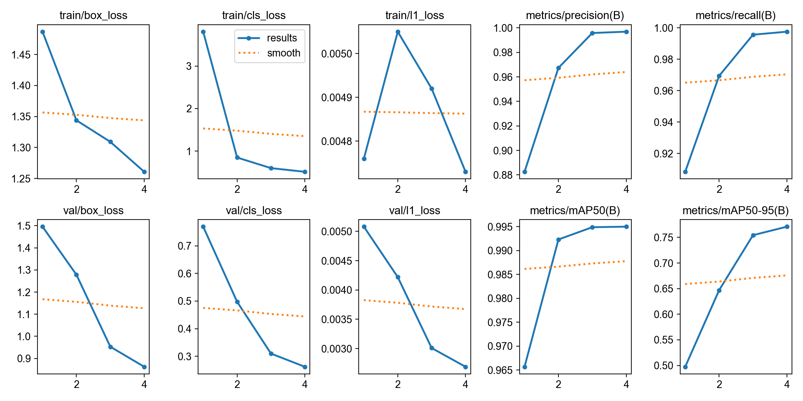

# UIUC RoboSub Vision Models

This repo is for building models we will eventually use for RoboSub vision:

```text
Get labeled data → train YOLO → evaluate → test on new images → integrate with ROS 2
```


## Repo structure

```text
card_detection/
├── dataset/
│   ├── data.yaml       # Paths and 52 card classes
│   ├── train/          # Gitignored
│   ├── valid/          # Gitignored
│   └── test/           # Gitignored
├── test_images/        # Images for manual testing
├── test_images_out/    # Predictions with boxes and labels
├── train.py            # Trains YOLO
└── test.py             # Runs best.pt on test_images

runs/detect/train-mac-card-detection/
├── results.csv         # Metrics by epoch
├── results.png         # Training plots
└── weights/
    ├── best.pt         # Best model for inference
    └── last.pt         # Final checkpoint
```

## Card detector

The example uses [this Roboflow playing-card dataset](https://universe.roboflow.com/augmented-startups/playing-cards-ow27d/dataset/4):

| Split | Images |
|---|---:|
| Train | 21,203 |
| Validation | 2,020 |
| Test | 1,010 |

It detects the rank/suit symbols in card corners, not entire cards.

### Training settings

```python
model = YOLO("yolo26n.pt")
model.train(
    data="card_detection/dataset/data.yaml",
    epochs=50,
    imgsz=640,
    batch=16,
    patience=10,
    time=1,
    device="mps",
)
```

- `yolo26n.pt`: pretrained Nano model; small and fast.
- `epochs`: maximum full passes through the dataset.
- `imgsz`: training image size.
- `batch`: images processed before each update.
- `patience`: stop after this many epochs without improvement.
- `time`: maximum training time in hours; overrides `epochs`.
- `device="mps"`: Apple Silicon GPU. Use `device=0` for an NVIDIA GPU.

### Results

The one-hour Mac run produced:

| Metric | Result |
|---|---:|
| Precision | 0.9969 |
| Recall | 0.9976 |
| mAP50 | 0.9950 |
| mAP50–95 | 0.7709 |

`mAP50` measures detection quality at 50% box overlap. `mAP50–95` averages stricter overlap thresholds.



## Run it

```bash
python3 -m venv .venv
source .venv/bin/activate
python -m pip install ultralytics

python card_detection/train.py
python card_detection/test.py
```

On Windows PowerShell, activate with:

```powershell
.venv\Scripts\Activate.ps1
```

Put new images in `card_detection/test_images/`. Predictions are saved to `card_detection/test_images_out/`.
